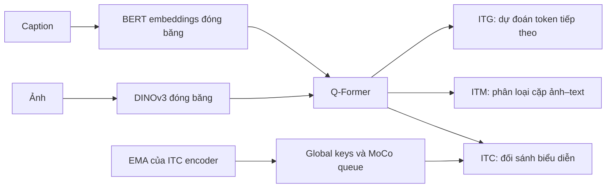

# InA-Bridge

InA-Bridge là dự án nghiên cứu mô hình thị giác–ngôn ngữ, kết nối **DINOv3 → Q-Former → Qwen3** theo hướng BLIP-2/InstructBLIP. Stage 1 học biểu diễn ảnh–văn bản bằng ITC, ITM và ITG; stage 2 dùng đặc trưng ảnh có điều kiện theo instruction làm prefix cho mô hình ngôn ngữ.

**Cập nhật: 10/10/2026**, dựa trên mã nguồn và kiểm thử trong thư mục làm việc hiện tại, bao gồm các thay đổi chưa commit. Dự án đã có pipeline stage 1 và các thành phần chính của stage 2; chưa hoàn tất nghiệm thu huấn luyện đa GPU và đánh giá chất lượng trên tập dữ liệu độc lập.

## Tiến độ

| Hạng mục | Đã triển khai | Phần còn lại |
| --- | --- | --- |
| Dữ liệu stage 1 | Manifest ảnh–caption, cache SQLite, image ID ổn định, batching theo độ dài, chia rank và mask mẫu đệm | Chốt dữ liệu sạch, tách train/validation/test, đo throughput thực tế |
| Mô hình stage 1 | Vision encoder đóng băng, Q-Former khởi tạo từ BERT, ba mục tiêu ITC/ITM/ITG | Huấn luyện đầy đủ với DINOv3 pretrained và đánh giá khả năng tổng quát hóa |
| Training stage 1 | FSDP2, BF16/FP32, accumulation, clipping, EMA, queue, validation, xử lý step không hữu hạn | Nghiệm thu NCCL đa GPU, đo VRAM và tốc độ |
| Checkpoint stage 1 | Pretrain, finetune, resume; checkpoint phân mảnh, RNG theo rank, con trỏ last/best | Kiểm chứng trên GPU và shared filesystem đích |
| Theo dõi training | Log riêng từng rank, TensorBoard, diagnostics và ví dụ validation | Thu thập số liệu từ run đầy đủ |
| LLM | Qwen3, LoRA/QLoRA NF4, visual prefix, sinh câu trả lời, lưu/nạp adapter và projector; test NF4 CUDA với model nhỏ đã đạt | Nghiệm thu Qwen3-4B trên dữ liệu và cấu hình thực |
| Stage 2 đa phương thức | `ModelStage2`, Q-Former nhận instruction, collator ảnh–prompt–answer, inference và export | Dataset/dataloader và engine training đa phương thức, checkpoint optimizer/RNG |
| SFT văn bản | CLI dựa trên `Trainer`, loss cho câu trả lời cuối, khởi tạo adapter và resume checkpoint | Chạy thực nghiệm trên dữ liệu mục tiêu |
| Quản lý artifact | Checkpoint và export trọng số đã có | `src/utils/artifacts.py` còn trống |

Hai cấu hình hiện tại cần đổi trước khi chạy thực nghiệm chính thức:

- `VISION_MOCK=True`: dùng Conv2d đóng băng để giả lập patch features, chưa dùng DINOv3 pretrained.
- `JSON_PATH_TRAIN` và `JSON_PATH_VAL` cùng trỏ tới một manifest: loss validation hiện không đo khả năng tổng quát hóa.

## Cấu trúc dự án

```text
src/
├── config.py                       # Cấu hình stage 1
├── vision.py                       # DINOv3 hoặc mock Conv2d
├── qformer.py                      # Query tokens, cross-attention và objective masks
├── projector.py                    # RMSNorm → Linear → SiLU → Dropout → Linear
├── languagemodel.py                # Qwen3, LoRA/QLoRA và visual prefix
├── data/
│   ├── dataloaderph1.py             # Dataloader cơ sở
│   ├── dataloaderph1_multilevel.py  # Dataloader dùng trong engine FSDP2
│   └── tokenizer.py                # Tiện ích/demo tokenization
├── trainingph1/
│   ├── model.py                    # ModelStage1
│   ├── engine.py                   # Training một GPU (FP32/BF16/FP16)
│   ├── engine_fsdp.py              # Training nhiều GPU bằng FSDP2
│   └── finetune.py                 # Còn trống; finetune qua engine_fsdp
├── trainingph2/
│   ├── model.py                    # ModelStage2, inference và export
│   ├── data.py                     # ChatCollator và InstructCollator
│   └── finetune.py                 # CLI SFT văn bản
├── losses/                         # ITC/ITM/ITG, bản cơ sở và FSDP
├── queue/                          # EMA và MoCo queue, bản cơ sở và FSDP
├── utils/                          # Checkpoint, RNG, logging, diagnostics
└── checkpoints/stage1/manager.json # Mô tả định dạng và quy tắc checkpoint
tests/                              # Unit/integration tests
FSDP/                               # Tài liệu thiết kế FSDP
environment.yml                     # Bản export môi trường Conda
```

Các thư mục local `DatasetProject/`, `cache/`, `outputs/`, `documents/` và trọng số checkpoint bị Git bỏ qua. Chúng không tự có sau khi clone. Trong bản local hiện có:

- `DatasetProject/HandleData/dowload.py`: lấy ảnh/caption bằng streaming; đường dẫn đầu ra đang gắn với máy phát triển.
- `DatasetProject/Analyst/`: script phân tích dữ liệu; `DatasetProject/BLIP3o/Report/` chứa báo cáo và danh sách mẫu bị gắn cờ.
- `outputs/convergence/`: script, JSON và báo cáo thử nghiệm overfit batch nhỏ.
- `documents/`: tài liệu tham khảo nghiên cứu.

## Kiến trúc và hành vi

### Stage 1: học biểu diễn ảnh–văn bản



Q-Former dùng các block BERT, có nhánh FFN riêng cho query và text. Cross-attention chỉ áp dụng cho query, mỗi `CROSS_ATTN_EVERY` block. Vision encoder loại CLS/register tokens, giữ patch features.

| Mục tiêu | Cách thực hiện |
| --- | --- |
| ITC | Query và text không self-attend lẫn nhau; chiếu về `ITC_DIM`, chuẩn hóa L2, lấy similarity lớn nhất theo query. Targets kết hợp nhãn cùng image ID và soft targets từ EMA. |
| ITM | Query/text tương tác hai chiều; một cặp đúng và hai nhánh âm ảnh/text. Hard negatives lấy trong batch local, loại ảnh cùng ID và mẫu đệm. Không có negative hợp lệ thì không tính loss ITM cho mẫu đó. |
| ITG | Query chỉ nhìn query; text nhìn query và các token trước. Thay embedding CLS đầu chuỗi bằng DEC embedding học được, dự đoán token dịch một vị trí. LM head dùng chung trọng số với word embeddings đóng băng. |

Với cấu hình mặc định, ảnh `[B, 3, 640, 640]` tạo patch features `[B, 1600, 1024]`, Q-Former tạo `[B, 128, 768]`, ITC image features có dạng `[B, 128, 256]` và text features `[B, 256]`.

FSDP2 shard toàn bộ tham số online và EMA, bao gồm frozen weights. EMA chỉ theo dõi ITC encoder; queue FP32 được sao chép đồng nhất trên mỗi rank, chứa tối đa `QUEUE_SIZE` phần tử mỗi rank. ITC dùng global keys của micro-batch hiện tại cộng queue cũ. Queue không thay đổi trong một nhóm accumulation; EMA và queue chỉ cập nhật sau optimizer step thành công.

Loss được chuẩn hóa theo số mẫu/cặp/token hợp lệ thực tế trên toàn nhóm accumulation và mọi rank. Các rank cùng bỏ qua update nếu loss hoặc gradient không hữu hạn. Scheduler tiến theo optimizer step thành công.

### Stage 2: ảnh + instruction → câu trả lời

`ModelStage2` nạp vision encoder, Q-Former và BERT embeddings từ checkpoint stage 1. Q-Former dùng mask hai chiều của ITM để instruction ảnh hưởng tới visual queries. Projector chuyển queries sang chiều embedding của Qwen3 rồi ghép trước embeddings của prompt.

- Vision encoder và BERT embeddings đóng băng; Q-Former có thể bật/tắt training bằng `train_qformer`.
- Qwen3 mặc định là `Qwen/Qwen3-4B`, QLoRA NF4 có double quantization; LoRA áp dụng `all-linear`, mặc định rank 16, alpha 32.
- `ChatCollator` chỉ giám sát câu trả lời assistant cuối và EOS; prompt/padding nhận label `-100`.
- `InstructCollator` nhận `image` đã transform thành tensor, `prompt`, `answer`; chỉ prompt đi vào Q-Former. Visual prefix cũng nhận label `-100`.
- `save_pretrained()` xuất adapter, tokenizer, projector, Q-Former và cấu hình tiền xử lý. Export này không chứa optimizer/RNG và vẫn cần checkpoint stage 1 gốc để nạp frozen backbone.

CLI `src.trainingph2.finetune` hiện chỉ SFT văn bản. Việc có `ModelStage2.forward()` và collator chưa đồng nghĩa đã có engine huấn luyện ảnh–instruction hoàn chỉnh.

## Môi trường và dữ liệu

Chạy các lệnh từ root dự án. Môi trường đối chiếu là Python 3.12, PyTorch `2.12.0+cu126`, Transformers `5.11.0`, cùng torchvision, PEFT, bitsandbytes, accelerate, ijson, Pillow và TensorBoard.

```bash
conda env create -f environment.yml
conda activate vlmmodel
```

`environment.yml` là bản export từ máy phát triển, có build CUDA và `prefix` tuyệt đối. Cần điều chỉnh đường dẫn/index gói theo máy đích nếu không tái tạo trực tiếp được; việc tạo lại môi trường từ đầu chưa được xác minh trong lần rà soát này. `pytest==9.1.1` đã được bổ sung vào manifest và cài trong môi trường `vlmmodel` để chạy kiểm thử.

QLoRA mặc định cần CUDA. API LLM có thể chạy LoRA trên CPU bằng `load_in_4bit=False, device="cpu"`; CLI SFT hiện không cung cấp lựa chọn này. Model/tokenizer pretrained cần có trong cache hoặc được tải khi khởi tạo; nếu cần xác thực Hugging Face, dùng `hf auth login`.

Manifest stage 1 là mảng JSON, mỗi phần tử có tối thiểu:

```json
[
  {"image_name": "000001.jpg", "text": "A dog is running on the grass."},
  {"image_name": "000002.jpg", "text": "Two people are sitting at a table."}
]
```

`image_name` tương đối với `IMAGE_DIR`. Các trường phụ như `dataset_name` không được loader sử dụng. Image ID được băm từ `DATASET_NAMESPACE` và đường dẫn ảnh tương đối, giúp nhận diện nhiều caption cùng ảnh và giữ ID khi di chuyển thư mục gốc.

Dataloader multilevel tạo `<namespace>_train.sqlite` và `<namespace>_validation.sqlite`, lưu caption và độ dài token. Cache được kiểm tra theo manifest, tokenizer và `MAX_LENGTH`. Engine điều phối rank 0 xây cache và truyền lỗi cho các rank còn lại; dataset chỉ tạo hoặc đọc cache qua `prepare_cache`. Thư mục cache phải truy cập được bởi các rank sử dụng nó.

`ema.py` dùng chung cho cả hai engine; `ema_fsdp.py` đã được gộp vào file này. Engine FSDP kiểm tra layout và truyền local tensor cho EMA cập nhật. EMA, loss, MoCo queue và dataloader multilevel không import API phân tán. Engine truyền `rank`, `num_replicas`, `pad_batches` cho sampler và chịu trách nhiệm gather, reduce, đồng bộ cache và quản lý shard.

MoCo queue dùng chung `src/queue/moco.py`; `moco_fsdp.py` đã được gộp vào file này. Queue quản lý FIFO, lọc `valid_mask` nếu được truyền vào và kiểm tra shape/dtype/device. Engine chịu trách nhiệm gather keys, đồng bộ queue và kiểm tra tensor chưa bị shard trước khi enqueue.

Loss stage 1 dùng chung `src/losses/lossph1.py`, trả tổng loss và số phần tử hợp lệ. Khi bỏ qua hoặc truyền `None` cho `valid_mask` (và `global_valid_mask` của ITC), loss mặc định dùng toàn `True` và in cảnh báo cần truyền mask loại mẫu đệm khi dùng FSDP.

Batch gồm `images`, `image_ids`, `input_ids`, `attention_mask`, `valid_mask`. Train hỗ trợ gom mẫu theo độ dài và shuffle theo seed/epoch. Với `DROP_LAST=False`, phần dư được đệm để đồng bộ rank và loại khỏi loss bằng `valid_mask`; validation luôn giữ mọi mẫu thật.

Bản local được đếm ngày 10/10/2026 có **100.000 bản ghi và 100.000 file ảnh**. Báo cáo phân tích local ghi 96.194 mẫu qua toàn bộ bộ lọc; đây là số liệu báo cáo trước đó, không phải kết quả kiểm tra lại nội dung ảnh. Loader hiện đọc manifest cấu hình và không tự áp dụng danh sách lọc.

## Chạy stage 1

Sửa [src/config.py](src/config.py) trước khi chạy:

| Nhóm | Cấu hình cần chú ý | Giá trị hiện tại |
| --- | --- | --- |
| Run | `TRAINING_MODE`, `MODEL_VERSION`, `RUN_NAME` | `pretrain`, `v1`, `pretrain_001` |
| Backbone | `VISION_MOCK`, `BERT_MODEL_ID`, `VISION_MODEL_ID` | Mock bật; BERT-base; DINOv3 ViT-L/16 |
| Dữ liệu | `JSON_PATH_TRAIN`, `JSON_PATH_VAL`, `IMAGE_DIR` | Cùng manifest BLIP3o cho train/val |
| Batch | `BATCH_SIZE`, `ACCUMULATION_STEPS` | 8 mỗi rank, accumulation 1 |
| Độ dài | `IMAGE_SIZE`, `MAX_LENGTH`, `NUM_QUERIES` | 640, 128, 128 |
| Tối ưu | `EPOCHS`, `LR`, `MIN_LR`, `WARMUP_EPOCHS` | 20, 1e-4, 5e-6, 1 |
| Loss | `ITC_WEIGHT`, `ITM_WEIGHT`, `ITG_WEIGHT` | 1 / 1 / 1 |
| EMA/queue | `MOMENTUM`, `QUEUE_SIZE`, `PSEUDO_WEIGHT` | 0.995, 4096, 0.4 |
| Runtime | `DEVICE`, `AMP_ENABLED`, `AMP_DTYPE` | CUDA, bật AMP, BF16 |
| Sự kiện | `SAVE_EVERY_STEPS`, `VAL_EVERY_STEPS`, `LOG_EVERY_STEPS` | 1000 / 1000 / 10 |

Batch global danh nghĩa = `BATCH_SIZE × WORLD_SIZE × ACCUMULATION_STEPS`. FSDP engine hỗ trợ BF16 hoặc FP32, chưa hỗ trợ FP16/GradScaler. Mỗi run mới cần `RUN_NAME` chưa tồn tại.

```bash
# Hai GPU, mỗi process một GPU
torchrun --standalone --nproc-per-node=2 -m src.trainingph1.engine_fsdp

# Một GPU, dùng DEVICE trong config
python -m src.trainingph1.engine
```

Engine một GPU từ chối chạy nhiều process; engine FSDP vẫn hỗ trợ một process không shard để đối chiếu. Cả hai engine đặt epoch và seed của sampler trước khi đọc dữ liệu, loại mẫu đệm khỏi loss/queue và chỉ cập nhật scheduler/EMA/queue sau optimizer step thành công.

Để chạy đối chiếu CPU, đặt `DEVICE="cpu"`; đặt `AMP_ENABLED=False` nếu cần FP32. Fine-tune stage 1 dùng cùng entry point trên, không chạy file `trainingph1/finetune.py` còn trống.

### Khởi tạo, fine-tune và resume

| Luồng | `TRAINING_MODE` | `INIT_CHECKPOINT` | `RESUME_CHECKPOINT` |
| --- | --- | --- | --- |
| Pretrain mới | `pretrain` | `None` | `None` |
| Resume pretrain | `pretrain` | `None` | Checkpoint pretrain |
| Finetune mới | `finetune` | Checkpoint nguồn | `None` |
| Resume finetune | `finetune` | `None` | Checkpoint finetune |

Finetune giữ kiến trúc, tokenizer và online weights, nhưng tạo run mới và reset optimizer, scheduler, EMA, queue, tiến độ. Resume khôi phục cấu hình đã lưu; `DEVICE` và tùy chọn logging/TensorBoard lấy từ cấu hình hiện tại.

Engine một GPU lưu `last.pt`/`best.pt` tại `<CHECKPOINT_DIR>/<MODEL_VERSION>/<RUN_NAME>`. Engine FSDP dùng format riêng bên dưới; resume phải dùng đúng engine đã tạo checkpoint. FSDP có thể dùng `.pt` để khởi tạo finetune. Engine một GPU hiện ghi `DATA_RNG_VERSION=2` cho sampler multilevel; checkpoint phiên bản cũ chỉ dùng qua `INIT_CHECKPOINT` vì không đảm bảo replay thứ tự dữ liệu khi resume.

Checkpoint FSDP format 1 nằm tại:

```text
src/checkpoints/stage1/<MODEL_VERSION>/<TRAINING_MODE>/<RUN_NAME>/
├── run.json
├── last.json / best.json
├── snapshots/<id>/
│   ├── checkpoint.json
│   ├── shards/
│   ├── shared.pt
│   └── rank-<rank>.pt
├── logs/rank-<rank>.log
└── tensorboard/
```

Có thể truyền run directory, `last.json`/`best.json` hoặc snapshot directory. Mọi rank cùng save/load; chỉ công bố con trỏ sau khi snapshot hoàn chỉnh. Giữ snapshot last/best và thu hồi snapshot bị thay thế. Chỉ lưu tại accumulation boundary sau `zero_grad`.

Resume yêu cầu khớp training mode, world size, distributed mode, loại device, phiên bản thư viện, fingerprint dữ liệu và số batch. Ảnh và mã mô hình cần giữ nguyên để replay tương đương. Copy toàn bộ thư mục run; không sửa `run.json`. Checkpoint `.pt` legacy format 5 chỉ dùng khởi tạo finetune, không resume FSDP. Xem [quy tắc checkpoint](src/checkpoints/stage1/manager.json).

### Theo dõi

```bash
tensorboard --logdir src/checkpoints/stage1
```

Rank 0 ghi loss, learning rate, step bị bỏ qua, thời gian checkpoint và diagnostics ITC/ITM/ITG, độ tương đồng biểu diễn, mức sử dụng token và gradient theo nhóm tham số. Diagnostics train chạy tại bước 1 và mỗi 50 step theo mặc định; validation đo toàn bộ. Khi resume, TensorBoard ẩn event sau checkpoint bằng `purge_step`.

Ảnh/caption và token dự đoán trong validation dùng **teacher forcing**: mỗi token nhìn thấy token đúng trước đó. Chúng chưa đo khả năng sinh caption tự do.

## Chạy SFT văn bản và inference stage 2

Chuẩn bị file JSON riêng, ví dụ `train_chat.json`:

```json
[
  {
    "messages": [
      {"role": "user", "content": "Explain what a visual encoder does."},
      {"role": "assistant", "content": "It converts an image into numerical features."}
    ]
  }
]
```

```bash
python -m src.trainingph2.finetune \
  --train train_chat.json --validation val_chat.json \
  --output outputs/qwen3-sft --epochs 3 --batch-size 1 --accumulation 8

# Tiếp tục cả optimizer/scheduler/RNG từ checkpoint Trainer
python -m src.trainingph2.finetune \
  --train train_chat.json --validation val_chat.json \
  --output outputs/qwen3-sft --resume outputs/qwen3-sft/checkpoint-100
```

`--validation` là tùy chọn; các file trong ví dụ cần tự chuẩn bị. `--adapter <path>` khởi tạo từ adapter và tạo optimizer mới; không dùng đồng thời với `--resume`. Adapter cuối được lưu ở `<output>/adapter`. `--enable-thinking` mặc định tắt.

Sau khi có checkpoint stage 1 và export stage 2 đã huấn luyện, API inference một ảnh + prompt:

```python
from src.trainingph2.model import ModelStage2

model = ModelStage2.from_stage1(
    "src/checkpoints/stage1/v1/pretrain/<run>/best.json",
    adapter_path="outputs/stage2/adapter",
    trainable=False,
)
answer = model.generation("example.jpg", "Describe this image.", max_new_tokens=128)
print(answer)
```

Đường dẫn trên là mẫu, không phải artifact đã phát hành. Nạp stage 1 rồi tạo projector mới chỉ kiểm tra được luồng tensor; cần huấn luyện stage 2 để có câu trả lời dựa trên ảnh đáng tin cậy.

## Kiểm thử và bằng chứng thực nghiệm

Bộ test dùng model/tokenizer/ảnh nhỏ cục bộ để kiểm tra loss, gradient, frozen weights, image ID, queue, accumulation, checkpoint/resume, diagnostics, LoRA và kết nối stage 2.

```bash
python -m unittest discover -s tests -v

# Bật test FSDP hai rank Gloo; cần quyền tạo process/socket cục bộ
RUN_DISTRIBUTED_TESTS=1 python -m unittest discover -s tests -v
```

Kết quả sau sửa lỗi ngày **10/10/2026**, môi trường `vlmmodel`, chạy ngoài sandbox để cho phép multiprocessing/socket và CUDA:

| Bộ test | Đạt | Bỏ qua | Phạm vi |
| --- | ---: | ---: | --- |
| Model, engine, loss, queue, checkpoint, logging, image ID | 86 | 1 | Bật `RUN_DISTRIBUTED_TESTS=1`; gồm FSDP hai rank Gloo và NF4 CUDA với Qwen3 nhỏ |
| Dataloader multilevel | 162 | 0 | Cache, grouping, padding mask, workers và Gloo hai rank |

Tổng hợp các lượt kiểm tra: **248 test đạt, 1 bỏ qua**. Test bị bỏ qua yêu cầu hai GPU CUDA. Sau lượt toàn bộ, bốn assertion dataloader còn dùng định dạng cũ đã được sửa và cả bộ 162 test dataloader được chạy lại thành công. Kết quả NF4 với model nhỏ chưa xác nhận training Qwen3-4B đầy đủ.

Đã sửa tạo cache mới trong `src/data/dataloaderph1.py`, lời gọi `dist.get_rank()` và đồng bộ mọi rank khi tạo/tái sử dụng cache. Test hồi quy kiểm tra cache, image ID và đồng bộ đã đạt. Bộ test multilevel được cập nhật theo fingerprint tokenizer, broadcast trạng thái cache và định dạng `(index, valid)` hiện tại.

```bash
python -m pytest tests/test_dataloaderph1_multilevel.py -q -ra
RUN_DISTRIBUTED_TESTS=1 python -m pytest tests -q -ra
```

`test_dataloaderph1_multilevel.py` đã được thêm ngoại lệ trong `.gitignore`. Hai file local `test_losses_fsdp.py`, `test_queue_fsdp.py` vẫn bị bỏ qua; một số test FSDP/LLM/logging và các bản sửa mới chưa commit. Vì vậy checkout chỉ từ commit hiện tại chưa tái tạo đầy đủ bộ kiểm thử local.

Báo cáo local `outputs/convergence/REPORT.md` ghi nhận thử nghiệm overfit 4 cặp ảnh–caption thật với DINOv3/BERT pretrained, 100 update CPU FP32: ITC `1.4163 → 0.0057`, ITM `0.6991 → 0.0006`, ITG `9.4842 → 0.0952`. Đây là batch nhỏ lặp lại, vision features được cache; báo cáo không xác nhận hội tụ trên toàn dữ liệu, held-out validation, free-running generation hay training FSDP đa GPU. Thí nghiệm này không được chạy lại trong lần cập nhật README.

## Ưu tiên tiếp theo

1. Đưa các test và bản sửa đã kiểm chứng vào Git để tái tạo bộ kiểm thử từ checkout sạch.
2. Tạo manifest sạch và tách train/validation/test theo ảnh; tránh cùng ảnh xuất hiện ở nhiều split.
3. Nghiệm thu stage 1 với `VISION_MOCK=False` trên nhiều GPU: BF16, resume giữa epoch, VRAM và throughput.
4. Chạy pretrain/finetune thực tế, đánh giá retrieval và generation trên tập độc lập.
5. Hoàn thiện dataset/dataloader, training loop và checkpoint trạng thái training cho stage 2 đa phương thức; nghiệm thu Qwen3-4B QLoRA trên GPU với dữ liệu thực.
6. Đánh giá ảnh–instruction–answer và đóng gói artifact inference có thể tái sử dụng.
